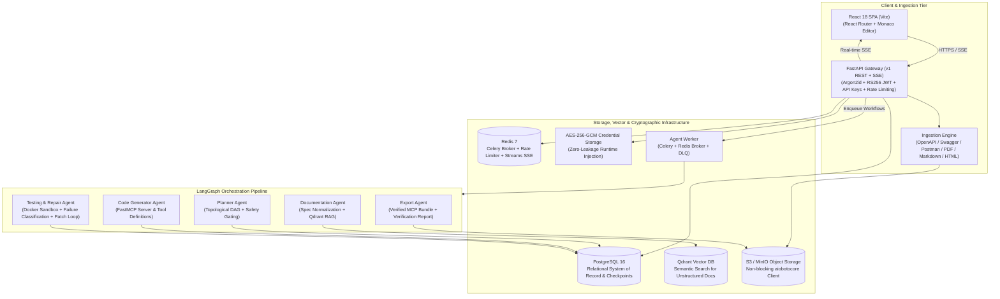

# APIWeaver

<div align="center">

**Autonomous REST-to-MCP Conversion & Verification Platform**

[](https://github.com/AJambla/APIWeaver-Autonomous-Multi-Agent-API-Integration-Platform/actions/workflows/ci.yml)
[](https://www.python.org/)
[](https://fastapi.tiangolo.com/)
[](https://react.dev/)
[](https://www.docker.com/)
[](LICENSE)

*Converts any REST API into verified, safety-gated Model Context Protocol (MCP) tools, backed by hermetic Docker sandbox validation, topological dependency resolution, and bounded self-healing.*

[About](#about-apiweaver) • [Architecture](#platform-architecture) • [Core Capabilities](#core-capabilities) • [Quick Start](#quick-start) • [Verification Hierarchy](#verification-hierarchy) • [Contributing](CONTRIBUTING.md) • [Security](SECURITY.md)

</div>

---

## About APIWeaver

Modern agentic AI applications (Claude Desktop, Cursor, LangGraph, AutoGen) require tools to interact with the real world. However, manually wrapping REST APIs into Model Context Protocol (MCP) tools is tedious, error-prone, and poses severe operational safety risks.

**APIWeaver** transforms this lifecycle from a manual engineering chore into an autonomous, verified pipeline:

1. **Heterogeneous Documentation Ingestion:** Ingests structured schemas (OpenAPI 3.x, Swagger 2.0, Postman Collections) as well as unstructured documents (PDFs, Markdown, HTML guides) via semantic RAG.
2. **Topological Dependency Resolution:** Derives parameter lineages, stateful prerequisites (e.g., `POST /auth/login` precedes `POST /orders`), and constructs an execution DAG.
3. **Safety Analysis & Confirmation Gates:** Automatically classifies destructive endpoints (`DELETE`, `revoke`, `purge`, `drop`), marking tools with `requires_confirmation = True` so AI agents cannot perform dangerous actions silently.
4. **First-Class FastMCP Tool Generation:** Produces clean, typed Model Context Protocol (MCP) server code and Pydantic models.
5. **Sandboxed Verification & Self-Healing:** Validates generated tools in an isolated, unprivileged Docker sandbox. When runtime defects occur, an LLM-driven diagnostic agent iteratively repairs code in up to 3 bounded self-healing cycles.
6. **Verified MCP Bundle Export:** Delivers a complete, deployable package (`server.py`, `tools.py`, `manifest.json`, `VERIFICATION_REPORT.md`, `VERIFICATION_REPORT.json`, and tests).

---

## Platform Architecture



---

## Core Capabilities

### 🔍 Multi-Format Documentation Ingestion
- Deterministic normalizers parse OpenAPI 3.0/3.1, Swagger 2.0, and Postman v2.1 specifications into a canonical internal schema.
- Built-in unstructured document parser chunks and indexes freeform PDFs, HTML pages, and Markdown files into Qdrant for semantic RAG retrieval.

### 🗺️ Topological Dependency Graphing
- Automatically constructs Directed Acyclic Graphs (DAGs) representing entity lifecycles.
- Identifies prerequisite chains (e.g., retrieving an auth token before querying customer endpoints).

### 🛡️ Safety Analysis & Confirmation Gating
- Automated operational risk classifier tags all destructive operations (`DELETE`, `drop`, `revoke`, `purge`).
- Generates FastMCP tools with `requires_confirmation = True`, requiring explicit human approval before execution in agent runtimes.

### ⚡ FastMCP Server Generation
- Generates official Model Context Protocol (MCP) Python tools using FastMCP.
- Strictly validates parameters and schemas using Pydantic v2.
- Handles pagination, auth injection, and error formatting automatically.

### 🧪 3-Level Verification Hierarchy & Self-Healing
1. **Level 1 (Static):** Syntax compilation, AST verification, and Pydantic schema validation.
2. **Level 2 (Sandbox):** Hermetic Docker container execution against synthetic fixtures with strict CPU, memory, and timeout bounds.
3. **Level 3 (Optional Live):** Controlled live endpoint testing with SSRF egress protection and private IP blocking.
4. **Bounded Self-Healing:** Up to 3 diagnostic repair iterations that classify runtime failures and synthesize targeted code patches.

### 📦 Verified MCP Server Bundle Export
- Packages `server.py`, `tools.py`, `dependencies.py`, `manifest.json`, and tests into a clean ZIP download.
- Emits human-readable `VERIFICATION_REPORT.md` and machine-readable `VERIFICATION_REPORT.json` documenting exact test outcomes and safety ratings.

---

## Quick Start

### 1. Prerequisites
- **Docker & Docker Compose**
- **Python 3.12+** & **Node.js 20+**

### 2. Boot Local Development Stack
```bash
# 1. Clone repository
git clone https://github.com/AJambla/APIWeaver.git
cd APIWeaver

# 2. Configure environment
cp .env.example .env

# 3. Boot all services via Docker Compose
docker compose -f docker-compose.dev.yml up -d --build
```

### 3. Service Endpoints

| Service | Endpoint | Description |
| :--- | :--- | :--- |
| **Web Dashboard** | [http://localhost:3000](http://localhost:3000) | React 18 integration and verification UI |
| **FastAPI Swagger Docs**| [http://localhost:8000/docs](http://localhost:8000/docs) | Interactive API documentation |
| **Health Probes** | [http://localhost:8000/readyz](http://localhost:8000/readyz) | Dependency readiness probe |
| **MinIO Console** | [http://localhost:9001](http://localhost:9001) | S3 storage UI (`minioadmin` / `minioadmin`) |
| **Qdrant Dashboard** | [http://localhost:6333/dashboard](http://localhost:6333/dashboard) | Vector collection explorer |

---

## Configuration Reference

Key variables configured via [`.env`](.env.example):

| Variable | Default | Purpose |
| :--- | :--- | :--- |
| `DATABASE_URL` | `postgresql+asyncpg://...` | PostgreSQL connection URL |
| `REDIS_URL` | `redis://localhost:6379/0` | Redis task queue and SSE broker |
| `QDRANT_URL` | `http://localhost:6333` | Qdrant vector database endpoint |
| `S3_ENDPOINT_URL` | `http://localhost:9000` | S3 / MinIO object storage endpoint |
| `APP_ENCRYPTION_KEY` | *(Secret)* | 32-byte base64 key for AES-256-GCM credential encryption |
| `SANDBOX_BACKEND` | `docker` | Sandbox isolation mode (`docker` enforced for tests) |
| `JWT_PRIVATE_KEY_PATH` | `/certs/jwtRS256.key` | RS256 RSA private key for JWT auth |
| `OPENAI_API_KEY` | *(Secret)* | LLM API key for planning and repair agents |

---

## License

Licensed under the [Apache License, Version 2.0](LICENSE).
